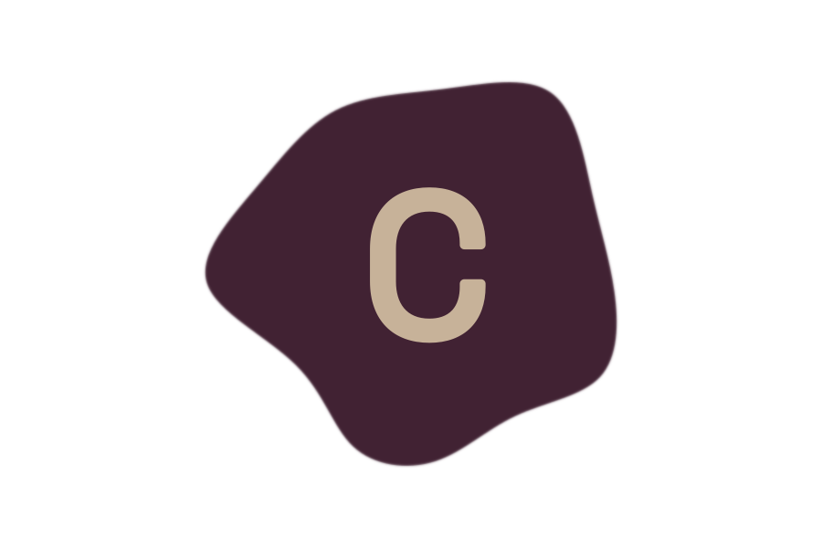

<p align="center">
  
</p>

<h1 align="center">Clay</h1>

<p align="center">
  <a href="https://github.com/yugaaank/clay/actions/workflows/check.yml">
    
  </a>
  <a href="https://github.com/yugaaank/clay/blob/main/LICENSE">
    
  </a>
  <a href="https://github.com/yugaaank/clay/stargazers">
    
  </a>
  
</p>

<p align="center">
  <a href="https://github.com/yugaaank/clay/blob/main/docs/getting-started.md">Documentation</a>
  <span>&nbsp;&nbsp;•&nbsp;&nbsp;</span>
  <a href="https://github.com/yugaaank/clay/tree/main/examples">Examples</a>
  <span>&nbsp;&nbsp;•&nbsp;&nbsp;</span>
  <a href="https://github.com/yugaaank/clay/issues">Issues</a>
  <span>&nbsp;&nbsp;•&nbsp;&nbsp;</span>
  <a href="https://github.com/yugaaank/clay/blob/main/CONTRIBUTING.md">Contributing</a>
  <br />
</p>

<p align="center">
  A small Rust application framework for building native desktop tools with GPUI.
</p>

<p align="center">
  <a href="https://github.com/yugaaank/clay/blob/main/docs/getting-started.md"><strong>Read the docs →</strong></a>
</p>

> **Status:** early Linux-focused prototype. Windows and macOS are not yet
> native-tested or supported release targets. This project is best suited to
> Rust developers building small native desktop tools.

## What is Clay?

Clay removes repetitive application bootstrap and common desktop UI
plumbing while keeping an explicit escape hatch to pinned GPUI APIs. It provides
application lifecycle, layouts, controls, themes, native services, and a CLI for
generating standalone Rust applications.

## What you can build today

- Window and application lifecycle through `App` and `Window`.
- Layout with `Column`, `Row`, and `Container`.
- `Text`, `Button`, `Checkbox`, and native single-line `TextInput` controls.
- Entity state, listeners, focus traversal, clipboard, Unicode editing, IME
  composition, and basic accessibility metadata.
- Semantic light/dark themes and spacing tokens.
- JSON settings persistence, background executor tasks, file selection, and
  confirmation dialogs.
- Generated projects through `clay new` and locked `dev`/`build`
  commands.

The framework does not yet provide tables, virtualized lists, form validation,
packaging, hot reload, plugins, or a TypeScript frontend.

## Choose your starting point

### Use the published CLI

After the `v0.3.0` tag is available on GitHub, install the CLI and generate an
independent application:

```sh
cargo install --locked \
  --git https://github.com/yugaaank/clay.git \
  --tag v0.3.0 \
  clay-cli \
  --bin clay

clay --version
clay new ./my-app
cd my-app
clay dev
```

If GitHub reports that `v0.3.0` does not exist yet, use the repository checkout
flow below or wait for the release tag to be published.

### Work from this repository

Install the Linux prerequisites described in
[`docs/getting-started.md`](docs/getting-started.md), then run an example:

```sh
cargo run --locked -p settings-app
cargo run --locked -p system-monitor
```

To develop the CLI and framework together, use the explicit local dependency:

```sh
cargo build --locked -p clay-cli
./target/debug/clay new ./my-app \
  --framework-path "$PWD/crates/clay"
cd my-app
../target/debug/clay dev
```

The generated application is its own Cargo workspace and lockfile. The CLI will
not overwrite an existing destination.

## Learn the framework

Start with [`docs/getting-started.md`](docs/getting-started.md). It covers
installation, project generation, the public API, state updates, settings,
background work, dialogs, testing, release builds, and troubleshooting.


Agents building applications should use the task-oriented
[`docs/ai/`](docs/ai/README.md) guides and the
[`llms.txt`](llms.txt) index. Agents changing the framework should read
[`AGENTS.md`](AGENTS.md).

The two runnable examples are:

- `examples/settings-app`: a persisted form with themes, clipboard, dialogs,
  focus, and background settings I/O.
- `examples/system-monitor`: background CPU, memory, uptime, and process
  collection with bounded history and explicit loading/error/empty states.

For advanced work, `clay::raw` exposes the pinned GPUI APIs for custom
elements, painting, lower-level events, and GPUI tasks.

## Contribute

Read [`CONTRIBUTING.md`](CONTRIBUTING.md) before starting work. Begin with an
issue labelled `good first issue` or `help wanted`, comment that you would like
to take it, then fork the repository and open a focused pull request with tests
and exact checks. Community behavior, support, and security reporting are
documented in [`CODE_OF_CONDUCT.md`](CODE_OF_CONDUCT.md), [`SUPPORT.md`](SUPPORT.md),
and [`SECURITY.md`](SECURITY.md).

The short-term priorities are reliable release/distribution workflows, Linux
developer experience, real application examples, reusable collection/form
patterns, and native platform validation. Hot reload, a TypeScript layer, visual
editing, plugins, and an updater are intentionally deferred.

Coding agents should read [`AGENTS.md`](AGENTS.md), the canonical engineering
instructions for this repository.

## Workspace

```text
crates/clay/             public facade and components
crates/clay-cli/         project generation and Cargo commands
examples/settings-app/  persisted settings example
examples/system-monitor/ bounded live metrics and process example
templates/minimal/      generated counter project
docs/getting-started.md setup and API guide
docs/ai/                application-agent guides and recipes
```

The facade does not link Zed's GPL `ui` crate. It uses the Apache-2.0 GPUI crates
directly and defines its own semantic tokens.

## Verification

```sh
cargo fmt --all -- --check
cargo check --workspace --locked
cargo test --workspace --all-features --locked
cargo clippy --workspace --all-targets --all-features --locked -- -D warnings
cargo doc --workspace --no-deps --locked
cargo build --workspace --release --locked
```

The verified Linux run includes 18 framework tests, 28 CLI/example tests, 2
doctests, a release build, a native settings window, and a system-monitor build.
The workspace was tested against GPUI revision
`56934ec0560bce8929025497411de7f5322fb6ca`.

## License

Apache-2.0. See [`LICENSE`](LICENSE). GPUI and the platform crates are also
Apache-2.0 at the pinned revision. Dependency licenses remain the responsibility
of applications when they redistribute a built product.
